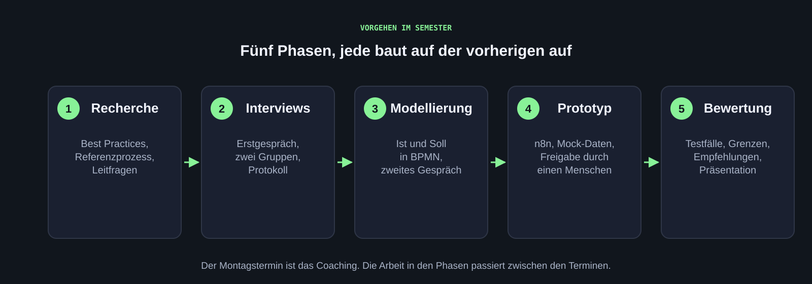

::: {.hero}
[HdM Stuttgart · WS 2026/27 · montags 11:45 bis 13:15 Uhr · Raum I110]{.hero-eyebrow}

# KI in der Verwaltung

[In diesem Projekt untersuchen wir gemeinsam mit Bereichen der HdM-Verwaltung, wo KI-Agenten Verwaltungsarbeit unterstützen können: vom Interview über das Prozessmodell bis zum Prototyp in n8n. Jeder Prototyp bereitet Entscheidungen vor, die Entscheidung bleibt beim Menschen.]{.hero-lead}

::: {.hero-actions}
<a href="projekt.html" class="btn btn-primary">Zum Projekt</a>
<a href="wochen/woche-01.html" class="btn btn-outline">Kick-off</a>
:::
:::

## Termine

| Termin | Was |
|---|---|
| [Kick-off](wochen/woche-01.qmd) | Kontext, Prozessmodellierung, Recherche-Auftrag, Gruppenbildung |
| [Werkzeuge](wochen/woche-02.qmd) | Coding-Agent, n8n, Prozessmodell mit dem Agenten |
| Coachings | wöchentlich montags, 11:45 bis 13:15 Uhr: Fragen, Rückmeldung zu Interviews, Modellierung und Prototyp |
| Abschlusspräsentation und Abgabe | Termine werden noch vereinbart, Details unter [Bewertung](bewertung.qmd) |

Der Wochentermin ist ein Coaching-Angebot. Interviews, Modellierung und Prototyp entstehen in der eigenständigen Projektarbeit zwischen den Terminen.

## So läuft das Projekt

{.abbildung fig-alt="Fünf Phasen als Kette: Recherche, Interviews, Modellierung, Prototyp, Bewertung."}

::: {.abb-cap}
So gehen wir vor: fünf Phasen, jede baut auf der vorherigen auf. Details auf der Seite [Projekt](projekt.qmd#vorgehen).
:::

## Nachschlagen

| Seite | Inhalt |
|---|---|
| [Vorbereitung](start.qmd) | HdM-VPN, Google-Konto, n8n-Zugang der Gruppe |
| [Projekt](projekt.qmd) | Ausgangslage, Vorgehen in fünf Phasen, Regeln für Daten und Freigaben |
| [Semesterplan](semester.qmd) | Kick-off und Werkzeuge im Detail, die weiteren Phasen als Rahmen |
| [Werkzeugkasten](werkzeuge/index.qmd) | Coding-Agent, Prozessmodellierung, Interviews, n8n |
| [Abgaben](abgaben.qmd) | Was in jeder Phase entsteht und wie es abgelegt wird |
| [Bewertung](bewertung.qmd) | Vorprüfungsleistung, Gewichte, Kriterien, Noten |
| [Materialien](materialien.qmd) | Literatur, Beispielprozesse, Prompts, Dokumentation |
