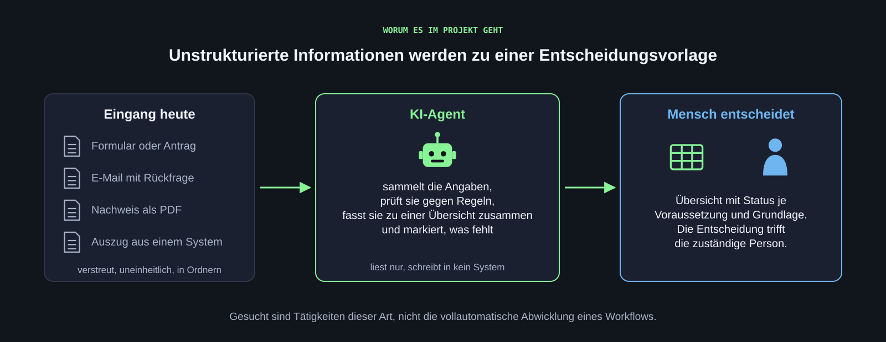
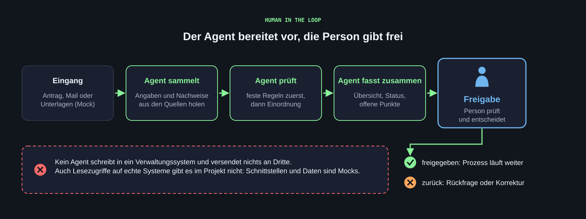
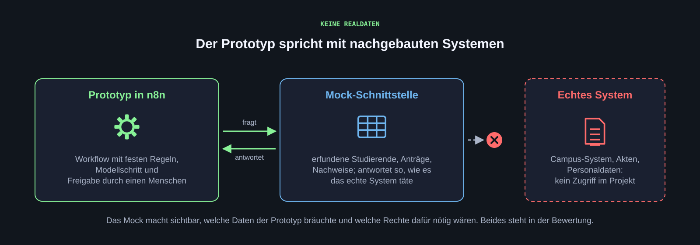

[Wo kann KI Verwaltungsarbeit an der HdM sinnvoll unterstützen? Wir beantworten diese Frage nicht am Schreibtisch, sondern im Gespräch mit Verwaltungsmitarbeitenden, mit einem Prozessmodell und mit einem Prototyp, den wir an Beispielfällen prüfen.]{.lead}

## Rahmen {#rahmen}

| Merkmal | Festlegung |
|---|---|
| Projektpartner | Bereiche der Hochschulverwaltung der HdM |
| Betreuung | [Prof. Dr. Stephan Wilczek](https://hdm-stuttgart.de/person/wilczek/) und [Prof. Dr. Jan Kirenz](https://hdm-stuttgart.de/person/kirenz/) |
| Termin | montags, 11:45 bis 13:15 Uhr, Raum I110, ab 12.10.2026 |
| Gruppen | Dreiergruppen, Einteilung in Woche 1 über eine kurze Umfrage |
| Sprache | Deutsch |
| Programmierung | keine Voraussetzung; Prototypen entstehen in n8n, Dateien schreibt der Coding-Agent |

Der Wochentermin dient der Abstimmung: Input, Rückmeldung zu Zwischenständen, Entscheidungen. Recherche, Interviews, Modellierung und Prototyp entstehen in der eigenständigen Arbeit der Gruppen. Die öffentliche [Projektbeschreibung](https://kirenz.github.io/hdm-projekte/projekte/ws-2026/ki-hochschulverwaltung.html) fasst Idee und Themenfelder zusammen.

## Ausgangslage {#ausgangslage}

Viele Abläufe in der Hochschulverwaltung sind formularbasiert: Ein Antrag wird eingereicht, formal vorgeprüft, inhaltlich geprüft, bei Fehlern zurückgegeben, am Ende unterschrieben. Die inhaltliche Prüfung bedeutet oft, Informationen aus mehreren Systemen zusammenzutragen und gegen Voraussetzungen abzugleichen. Dokumentiert wird das häufig in persönlichen Ordnern, nicht im System. Das kostet Zeit, und die Prüflogik steckt im Kopf der prüfenden Person.

Genau an dieser Stelle setzen wir an. Wir suchen Tätigkeiten, bei denen Mitarbeitende

- **unstrukturierte Informationen in strukturierte überführen:** aus Formularen, Mails, Unterlagen und Systemauszügen eine Übersicht, Tabelle oder Zusammenfassung erstellen,
- **Voraussetzungen prüfen:** Angaben gegen Regeln und Nachweise abgleichen, Lücken finden, Rückfragen formulieren,
- **Entscheidungen vorbereiten:** das Ergebnis so aufbereiten, dass eine Person schnell und begründet entscheiden kann.

Wir suchen nicht die vollautomatische Abwicklung eines Workflows. Die Verwaltung gibt einem Agenten keinen Schreibzugriff auf ihre Systeme, und auch Lesezugriffe sind nicht selbstverständlich. Der Agent liefert eine Vorlage, der Mensch entscheidet.

{.abbildung fig-alt="Links verstreute Eingänge wie Formular, Mail, PDF und Systemauszug, in der Mitte der KI-Agent, der sammelt, prüft und zusammenfasst, rechts eine Übersicht und die Person, die entscheidet."}

::: {.abb-cap}
Der Agent überführt verstreute Angaben in eine Übersicht mit Status je Voraussetzung. Die Entscheidung bleibt bei der zuständigen Person.
:::

### Mögliche Bereiche

Beispiele für Prozesse, um die es gehen kann:

| Bereich | Tätigkeit, um die es gehen könnte |
|---|---|
| Prüfungsausschuss | Anmeldung einer Abschlussarbeit: Prüfen, ob alle Voraussetzungen erfüllt sind (Leistungspunkte, Praxissemester, weitere Nachweise), Informationen aus mehreren Systemen, Dokumentation der Entscheidung |
| Berufungskommissionen | Übersicht über eingegangene Bewerbungsunterlagen für einen Erstüberblick, ausschließlich als Hinweis, ohne Entscheidung, ausschließlich lokal verarbeitet |
| Digitalisierung und Dokumentenmanagement | Hochschulweites Dokumentenmanagementsystem, Überlegungen zu Workflows; möglicher Adressat der Projektergebnisse |
| Finanzen, Personal | Wiederkehrende Prüf- und Übersichtsaufgaben, Details im Interview |

Interviewpartnerinnen und Interviewpartner nennen wir auf dieser Website nicht namentlich. In Protokollen und Modellen verwenden wir Rollen, keine Namen.

## Vorgehen in fünf Phasen {#vorgehen}

| Phase | Was wir tun | Ergebnis |
|---|---|---|
| 1 · Recherche | Best Practices für KI in der Verwaltung recherchieren, einen Referenzprozess mit dem Coding-Agenten skizzieren, Leitfragen für das Interview ableiten | Recherche-Skizze, Referenzmodell, Interviewleitfaden |
| 2 · Interviews | Ein Erstgespräch mit Verwaltungsmitarbeitenden führen, jeweils zwei Gruppen gemeinsam, Protokoll statt Aufnahme | Protokoll, Liste offener Fragen |
| 3 · Modellierung | Den Ablauf heute als BPMN-Modell abbilden (Ist), dann den Ablauf mit KI-Agent entwerfen (Soll); ein zweites Gespräch zum Nachschärfen; das Ergebnis der interviewten Person vorstellen | Ist- und Soll-Modell, bestätigt oder mit Korrekturen |
| 4 · Prototyp | Den Soll-Prozess als n8n-Workflow umsetzen: mit Mock-Daten, mit Freigabe durch einen Menschen, ohne Zugriff auf echte Systeme | Lauffähiger Prototyp mit Testfällen |
| 5 · Bewertung | Den Prototyp an Testfällen prüfen, Grenzen dokumentieren, Empfehlungen formulieren | Bewertung, Empfehlungen, Abschlusspräsentation |

Die Phasen bauen aufeinander auf. Wochen 1 und 2 stehen im [Semesterplan](semester.qmd) im Detail, die übrigen Phasen als Rahmen; ihre Termine vereinbaren wir im Semester.

{.abbildung fig-alt="Fünf Phasen als Kette: Recherche, Interviews, Modellierung, Prototyp, Bewertung."}

::: {.abb-cap}
Die fünf Phasen des Projekts. Der Montagstermin dient der Abstimmung, die Arbeit passiert dazwischen.
:::

### Warum zuerst recherchieren

Wer ohne Vorbereitung ins Interview geht, fragt nach dem, was er schon kennt. Die Recherche liefert Vokabular und Vergleichsfälle: Wie lösen andere Hochschulen und Behörden ähnliche Aufgaben, welche Muster wiederholen sich, was ging schief? Daraus entsteht ein Referenzprozess als Hypothese. Im Interview prüfen wir diese Hypothese, statt sie bestätigen zu lassen. Die wichtigsten Quellen stehen bei den [Materialien](materialien.qmd#literatur), Praxisbeispiele aus Land, Bund und Kommunen unter [Praxis und Rahmen](materialien.qmd#praxis).

### Warum ein Prozessmodell

Ein Modell macht sichtbar, wer welchen Schritt ausführt, wo entschieden wird, wo Informationen herkommen und wo heute Zeit verloren geht. Es trennt drei Arten von Schritten: feste Regeln (ohne KI prüfbar), Modellschritte (Sprachverständnis nötig) und menschliche Entscheidungen. Erst mit dieser Trennung lässt sich sagen, wo ein Agent hilft und wo nicht. Der Coding-Agent kann aus einem klaren Modell einen ersten Workflow erzeugen; wir prüfen ihn gegen das Modell. Grundlagen: [Prozessmodellierung](werkzeuge/prozessmodell.qmd).

### Warum zwei Gespräche

Nach dem ersten Interview fehlen erfahrungsgemäß Rollen, Ausnahmen und Rückschleifen: Was passiert, wenn ein Nachweis fehlt? Wer wird informiert? Das fällt beim Modellieren auf. Das zweite Gespräch klärt diese Lücken. Danach stellen wir das Modell der interviewten Person vor: „So haben wir Ihren Ablauf verstanden. Stimmt das?“

## Daten und Freigaben {#regeln}

::: {.callout-important title="Human in the Loop ist Pflicht"}
Jeder Prototyp endet mit einer Prüfung durch einen Menschen. Der Agent sammelt, prüft, fasst zusammen und schlägt vor. Die Freigabe erfolgt durch die zuständige Person, zum Beispiel per Antwort auf eine Nachricht, in einem Chat oder über eine einfache Web-Oberfläche. Erst danach geht der Prozess weiter. Kein Prototyp schreibt in ein Verwaltungssystem.
:::

{.abbildung fig-alt="Kette aus Eingang, Agent sammelt, Agent prüft, Agent fasst zusammen und Freigabe durch eine Person; darunter der Hinweis, dass kein Agent in ein Verwaltungssystem schreibt."}

::: {.abb-cap}
Der Agent bereitet vor, die Person gibt frei oder gibt zurück. Schreibzugriffe auf Verwaltungssysteme gibt es im Projekt nicht.
:::

**Keine Realdaten.** Schnittstellen und Daten bauen wir nach (Mocks): eine synthetische Tabelle mit erfundenen Studierenden, eine kleine Web-Schnittstelle, die so antwortet, wie es das echte System täte, ein Ordner mit erfundenen Anträgen. Der Prototyp zeigt dann: „So würde der Agent auf das System zugreifen, und das würde er zurückbekommen.“ Welche Daten und Schnittstellen nicht real sind, steht in der Dokumentation.

{.abbildung fig-alt="Prototyp in n8n fragt eine Mock-Schnittstelle mit erfundenen Daten; der Weg zum echten System ist durchgestrichen."}

::: {.abb-cap}
Der Prototyp spricht nur mit nachgebauten Systemen. Das Mock macht sichtbar, welche Daten und Rechte ein realer Einsatz bräuchte.
:::

**Sensible Inhalte bleiben lokal.** Bewerbungsunterlagen, Personalakten und ähnliche Inhalte dürfen nicht in öffentliche Cloud-Dienste gelangen. Für solche Fälle kommen nur lokal oder in Europa betriebene Modelle in Frage. Die Gemini-Verbindung in n8n ist für synthetische Daten vorgesehen.

**Interviews werden nicht aufgezeichnet.** Zwei Gruppen führen ein Gespräch gemeinsam, eine Person protokolliert. Ohne ausdrückliche Zustimmung der Gesprächspartnerinnen und Gesprächspartner nehmen wir nicht auf.

## Experimenteller Charakter {#experiment}

Das Projekt ist ausdrücklich ein Experiment. Am Ende muss nicht überall ein Prototyp stehen, der sofort einsetzbar wäre. Eine gut begründete Erkenntnis, dass ein Prozess sich mit den heutigen Mitteln nicht sinnvoll unterstützen lässt, ist ein vollwertiges Ergebnis. Die Grenzen der Systeme sind Teil unseres Auftrags: Was geht, was geht nicht, was fehlt dafür (Daten, Schnittstellen, Rechte, Modellqualität)?

Die Ergebnisse stellen wir am Semesterende den beteiligten Verwaltungsbereichen vor. Was daraus wird, entscheidet die Hochschule.

[**Weiter zum Semesterplan**](semester.qmd)
