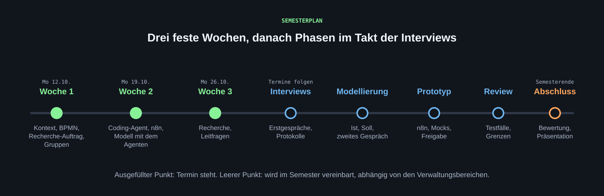

[Der Plan nennt die ersten beiden Wochen im Detail. Die weiteren Phasen sind als Rahmen beschrieben; ihre Termine werden im Semester vereinbart, abhängig davon, wann die Interviews stattfinden.]{.lead}

{.abbildung fig-alt="Zeitstrahl: Woche 1 am 12.10. und Woche 2 am 19.10. als feste Punkte, danach Interviews, Modellierung, Prototyp, Review und Abschluss ohne Termine."}

::: {.abb-cap}
Zwei feste Wochen, danach Phasen im Takt der Interviews. Leere Punkte werden im Semester vereinbart.
:::

## Wöchentlicher Termin

Montags, 11:45 bis 13:15 Uhr, Raum I110. Ein typischer Termin: 15 Minuten gemeinsamer Input oder Befund, danach Rückmeldung zu den Zwischenständen der Gruppen, am Ende Entscheidungen für die nächste Woche. Die Gruppen arbeiten zwischen den Terminen eigenständig weiter.

## Die ersten beiden Wochen

| Woche | Termin | Inhalt |
|---|---|---|
| [1](wochen/woche-01.qmd) | Montag, 12.10.2026 | Kontext: Verwaltung und KI-Agenten · Grundlagen der Prozessmodellierung (BPMN) · Recherche-Auftrag · Umfrage und Gruppenbildung |
| [2](wochen/woche-02.qmd) | Montag, 19.10.2026 | Ergebnisse der Recherche · Coding-Agent einrichten (Antigravity) · n8n-Einstieg auf dem HdM-Server · Prozessmodell mit dem Agenten erzeugen |

## Die weiteren Phasen

| Phase | Was passiert | Ergebnis zum Wochentermin |
|---|---|---|
| Interviews | Erstgespräche mit den Verwaltungsbereichen, je zwei Gruppen gemeinsam. Vorbereitung mit Leitfaden, Protokoll statt Aufnahme | Protokoll und offene Fragen |
| Modellierung | Ist-Prozess aus dem Protokoll modellieren, Soll-Prozess mit KI-Agent entwerfen, zweites Gespräch zum Nachschärfen, Vorstellung beim Interviewpartner | Ist- und Soll-Modell, bestätigt |
| Prototyp | Soll-Prozess in n8n umsetzen: Mock-Daten und Mock-Schnittstellen, Modellschritte, Freigabe durch einen Menschen | Lauffähiger Workflow mit ersten Testfällen |
| Review | Prototypen gegenseitig prüfen, Testfälle ergänzen, Grenzen dokumentieren | Testprotokoll, Liste der Grenzen |
| Bewertung und Abschluss | Bewertung, Empfehlungen, Abschlusspräsentation vor den beteiligten Bereichen | Präsentation und Abgabe |

Die Reihenfolge der Interviews hängt von der Verfügbarkeit der Verwaltungsbereiche ab. Gruppen, die noch auf ihr Interview warten, arbeiten an Recherche, Referenzmodell und Mock-Daten weiter.

## Was jede Woche gilt

1. Vor dem Termin den Stand in der Teamablage aktualisieren: Was ist fertig, was ist offen, wo hakt es?
2. Eine Person pro Gruppe stellt den Stand in zwei Minuten vor, ohne Folien.
3. Entscheidungen aus dem Termin mit Datum in der Ablage festhalten.
