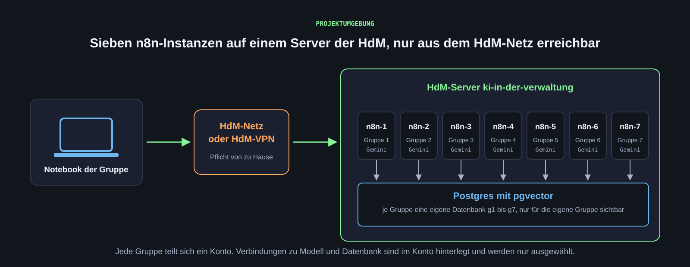

[Für den Einstieg genügen ein Notebook, der HdM-VPN-Zugang und ein Google-Konto. Programmierkenntnisse sind keine Voraussetzung. Der Zugang zur n8n-Umgebung wird pro Gruppe bereitgestellt.]{.lead}

## HdM-VPN {#vpn}

Die Projektumgebung (n8n und Datenbanken) läuft auf einem Server der HdM. Sie ist nur aus dem HdM-Netz und über das HdM-VPN erreichbar. Von zu Hause ist das VPN deshalb Voraussetzung für jede Arbeit in n8n.

1. Den VPN-Client der HdM installieren (FortiClient, Zugang mit der HdM-Kennung).
2. Die VPN-Verbindung aufbauen.
3. Prüfen: Die [Übersichtsseite der Projektumgebung](https://ki-in-der-verwaltung.iuk.hdm-stuttgart.de/) lädt im Browser. Ohne VPN erscheint eine Zeitüberschreitung.

Im Hochschulnetz vor Ort (WLAN eduroam oder Kabel) ist kein VPN nötig.

## Google-Konto und Coding-Agent {#google}

Wir arbeiten mit einem Coding-Agenten: Der Agent recherchiert, schreibt Prozessmodelle und Workflow-Dateien, wir prüfen und entscheiden. Welcher Anbieter das ist, spielt für das Vorgehen keine Rolle: [Claude Code](https://claude.com/claude-code), [OpenAI Codex](https://openai.com/codex/), [Cursor](https://cursor.com/) oder andere Werkzeuge funktionieren genauso. Wir verwenden [Google Antigravity](https://antigravity.google/), eine Entwicklungsumgebung mit eingebautem Agenten, weil Studierende sie derzeit über das Google-Jahresabo kostenfrei bekommen. Wer bereits einen anderen Coding-Agenten nutzt, kann dabei bleiben. Die Einrichtung erfolgt gemeinsam beim [Werkzeugtermin](wochen/woche-02.qmd).

::: {.callout-tip title="Google AI Plus für Studierende"}
Google stellt Studierenden ein Jahr lang [Google AI Plus](https://gemini.google/de/students/?hl=de) kostenlos bereit. Darin enthalten sind Gemini mit höheren Nutzungslimits und der Zugang zu Antigravity. Das Angebot gilt ab 18 Jahren und ist bis 31.12.2026 einlösbar.

Vor der Registrierung drei Punkte kennen:

- Die Berechtigung als Studierende oder Studierender wird nachgewiesen und jährlich erneuert.
- Bei der Registrierung ist eine gültige Zahlungsmethode erforderlich.
- Ohne rechtzeitige Kündigung verlängert sich das Abo nach Ablauf automatisch kostenpflichtig. Die aktuellen Bedingungen stehen auf der Angebotsseite.

Wer das Abo nicht möchte, arbeitet mit dem kostenlosen Google-Konto. Pro Gruppe reicht ein Zugang zu Antigravity; die Gruppe entscheidet, wer ihn einrichtet.
:::

Für die Modellaufrufe in n8n wird **nicht** das eigene Google-Konto verwendet. Dort ist pro Gruppe eine vorbereitete Verbindung hinterlegt, siehe [n8n auf dem HdM-Server](werkzeuge/n8n.qmd#gemini).

## n8n-Zugang der Gruppe {#n8n}

Jede Gruppe hat eine eigene n8n-Instanz mit eigener Datenbank auf dem HdM-Server. Die Gruppe teilt sich ein Konto. Login und Passwort werden nach der Gruppeneinteilung bereitgestellt. Das Passwort wird nicht per Mail, Chat oder in Dokumenten weitergegeben und nicht in Screenshots gezeigt.

| Gruppe | Adresse |
|---|---|
| Gruppe 1 | `https://ki-in-der-verwaltung.iuk.hdm-stuttgart.de/n8n-1/` |
| Gruppe 2 | `https://ki-in-der-verwaltung.iuk.hdm-stuttgart.de/n8n-2/` |
| Gruppe 3 | `https://ki-in-der-verwaltung.iuk.hdm-stuttgart.de/n8n-3/` |
| Gruppe 4 | `https://ki-in-der-verwaltung.iuk.hdm-stuttgart.de/n8n-4/` |
| Gruppe 5 | `https://ki-in-der-verwaltung.iuk.hdm-stuttgart.de/n8n-5/` |
| Gruppe 6 | `https://ki-in-der-verwaltung.iuk.hdm-stuttgart.de/n8n-6/` |
| Gruppe 7 | `https://ki-in-der-verwaltung.iuk.hdm-stuttgart.de/n8n-7/` |

Im Konto liegen bereits zwei Verbindungen: eine zur Gruppen-Datenbank (Postgres mit pgvector) und eine zum Sprachmodell (Gemini). Beide werden in Workflows ausgewählt, nicht neu angelegt. Erste Schritte: [n8n auf dem HdM-Server](werkzeuge/n8n.qmd).

{.abbildung fig-alt="Notebook der Gruppe über HdM-Netz oder VPN zum HdM-Server mit sieben n8n-Instanzen und einer Postgres-Datenbank mit pgvector."}

::: {.abb-cap}
Die Projektumgebung: sieben n8n-Instanzen und eine Datenbank je Gruppe auf einem Server der HdM, erreichbar nur aus dem HdM-Netz und über VPN.
:::

## Teamablage {#ablage}

Jede Gruppe arbeitet in einem gemeinsamen Ordner, zum Beispiel in Google Drive oder in einem privaten GitHub-Repository. Die Struktur gibt es fertig als Download: fünf Ordner mit je einer README, die sagt, was hineingehört und woran man prüft, dass es vollständig ist, dazu Vorlagen für Team, Stand, Entscheidungen und die AGENTS.md für den Coding-Agenten.

<a href="material/vorlagen/teamablage-vorlage.zip" class="btn btn-primary">Teamablage als ZIP herunterladen</a>

| Ordner | Inhalt |
|---|---|
| `01_Recherche` | Best Practices, Referenzprozesse, Quellen |
| `02_Interviews` | Leitfaden, Protokolle, offene Fragen |
| `03_Prozessmodelle` | Ist- und Soll-Modelle als `.bpmn` und als Bild |
| `04_Prototyp` | n8n-Exporte, Prompts im Wortlaut, Testfälle, Mock-Daten |
| `05_Bewertung` | Testbelege, Vergleich, Empfehlungen, Präsentation |

Zugangsdaten, Passwörter und Schlüssel gehören nicht in die Ablage, auch nicht in n8n-Exporte oder Screenshots.

## Arbeitsregeln {#regeln}

- **Keine Realdaten.** In n8n, Gemini und Antigravity verarbeiten wir ausschließlich synthetische oder anonymisierte Daten. Namen, Matrikelnummern, Bewerbungsunterlagen oder interne Dokumente der Verwaltung gehören nicht hinein. Die Gründe stehen unter [Daten und Freigaben](projekt.qmd#regeln).
- **Interviews werden protokolliert.** Eine Tonaufnahme ist nur mit ausdrücklicher Zustimmung der Gesprächspartnerin oder des Gesprächspartners erlaubt und wird ausschließlich lokal transkribiert. Siehe [Interviews führen](werkzeuge/interviews.qmd#aufnahme).
- **Der Mensch entscheidet.** Jeder Prototyp endet mit einer Prüfung und Freigabe durch eine Person. Kein Workflow schreibt in ein Verwaltungssystem oder versendet etwas an Dritte.

[**Weiter zum Projekt**](projekt.qmd)
