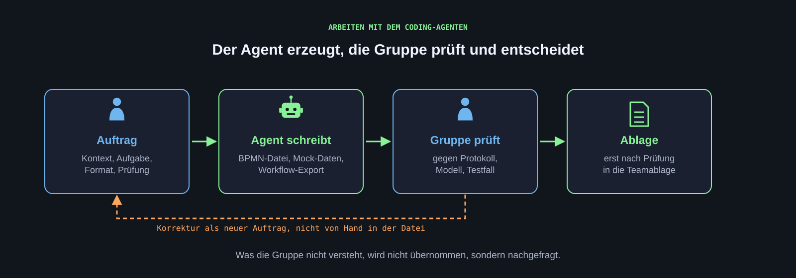
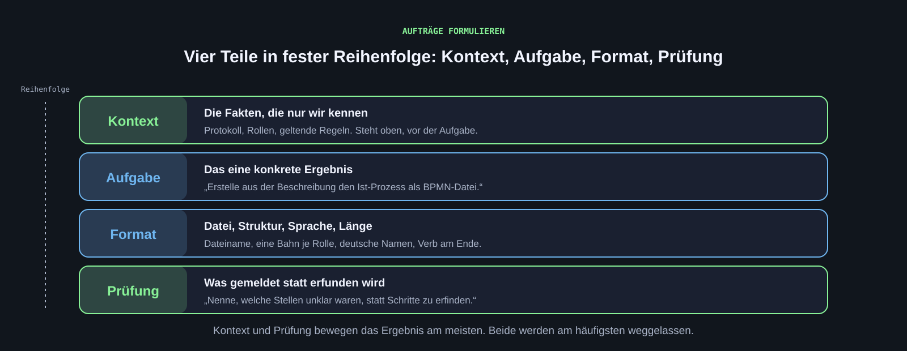

[Ein Coding-Agent schreibt Dateien: Prozessmodelle, Mock-Daten, Workflow-Exporte, kleine Web-Oberflächen. Wir geben Richtung und Kontext, prüfen jedes Ergebnis und entscheiden. Diese Seite beschreibt die Einrichtung von Antigravity und den Prompt-Standard für Aufträge.]{.lead}

## Google Antigravity {#antigravity}

[Google Antigravity](https://antigravity.google/) ist eine Entwicklungsumgebung mit eingebautem Agenten. Der Agent liest die Dateien im Projektordner, schreibt neue Dateien und ändert bestehende. Alles, was er tut, ist im Ordner sichtbar und kann rückgängig gemacht werden.

Antigravity ist nicht die einzige Wahl. Claude Code, OpenAI Codex, Cursor und ähnliche Werkzeuge arbeiten nach demselben Prinzip; die Aufträge und die AGENTS.md auf dieser Seite funktionieren dort ebenso. Wir nehmen Antigravity, weil es im Google-Jahresabo für Studierende enthalten ist und damit nichts kostet.

**Voraussetzungen:** ein Google-Konto; der Zugang zu Antigravity ist im [Studierendenangebot](../start.qmd#google) enthalten. Pro Gruppe reicht eine Installation.

1. Antigravity und die [Antigravity IDE](https://antigravity.google/product/antigravity-ide/) herunterladen und installieren.
2. Mit dem Google-Konto anmelden.
3. Einen leeren Projektordner anlegen, zum Beispiel `KI-Verwaltung`.
4. Links im Menü bei „Project“ auf „Create new Project“ klicken und den Ordner auswählen.
5. Prüfen: Links erscheint der Ordner, rechts der Chat mit dem Agenten.

**Wenn die Installation nicht klappt:** Den Auftrag in den Gemini-Chat im Browser einfügen, zusammen mit dem Inhalt der betroffenen Dateien als Text. Die Ausgabe als Datei speichern. Das ist umständlicher, führt aber zum selben Ergebnis.

{.abbildung fig-alt="Kette aus Auftrag, Agent schreibt, wir prüfen und Ablage; eine Rückschleife führt von der Prüfung als neuer Auftrag zurück."}

::: {.abb-cap}
Der Agent erzeugt, wir prüfen. Korrekturen formulieren wir als neuen Auftrag, nicht von Hand in der Datei.
:::

## AGENTS.md: Kontext für den Agenten {#agents-md}

Eine Datei `AGENTS.md` im Projektordner gibt dem Agenten den Kontext: worum es geht, wo was liegt, welche Regeln gelten. Der Agent liest sie zu Beginn jedes Auftrags. Nur Regeln eintragen, die wirklich gelten; die Datei wächst mit dem Projekt. Beispiele auf [agents.md](https://agents.md/).

Vorlage zum Anpassen:

```markdown
# Projekt: KI in der Verwaltung, Gruppe N

## Worum es geht
Wir untersuchen, ob ein KI-Agent die <Rolle> bei <Tätigkeit> unterstützen kann:
<unstrukturierte Eingaben> in eine <strukturierte Übersicht> überführen und
eine Entscheidung vorbereiten. Die Entscheidung trifft ein Mensch.

## Ordner
- 01_Recherche: Quellen und Referenzprozess
- 03_Prozessmodelle: BPMN-Dateien (Ist und Soll)
- 04_Prototyp: n8n-Exporte, Prompts, Mock-Daten, Testfälle

## Regeln
- Deutsch. Keine langen Gedankenstriche.
- Keine Realdaten. Alle Beispieldaten sind erfunden und als solche gekennzeichnet.
- Freigabe, Versand und Entscheidungen bleiben beim Menschen.
- Keine Zahlen erfinden. Unklares als offene Frage markieren, nicht raten.
- Zugangsdaten nie in Dateien schreiben.
```

## Aufträge formulieren: der Prompt-Standard {#prompt}

Ein guter Auftrag hat vier Teile, in dieser Reihenfolge: **Kontext, Aufgabe, Format, Prüfung.** Das Modell kennt das Handwerk. Was es nicht kennen kann, liegt nur bei uns, deshalb bewegen Kontext und Prüfung das Ergebnis am meisten.

| Teil | Was hinein gehört | Beispiel |
|---|---|---|
| Kontext | Die Fakten, die nur wir kennen | Die Prozessbeschreibung aus dem Interview, die beteiligten Rollen, die geltenden Regeln |
| Aufgabe | Das eine konkrete Ergebnis | Erstelle aus der Beschreibung den Ist-Prozess als BPMN-Datei |
| Format | Dateiname, Struktur, Sprache, Länge | Datei `antrag-ist.bpmn`, eine Bahn je Rolle, Namen deutsch, Verb am Ende |
| Prüfung | Was das Modell melden soll, statt Lücken zu füllen | Nenne am Ende, welche Schritte in der Beschreibung unklar waren, statt sie zu erfinden |

```default
Kontext: <Prozessbeschreibung und Rollen einfügen. Alle Angaben stammen aus
dem Interviewprotokoll vom <Datum>; Namen sind durch Rollen ersetzt.>

Aufgabe: Erstelle aus dieser Beschreibung den heutigen Ablauf als
BPMN-2.0-Datei. Jeder Satz der Beschreibung wird höchstens ein Schritt.

Format: Datei 03_Prozessmodelle/antrag-ist.bpmn. Eine Bahn je Rolle.
Schrittnamen deutsch mit Verb am Ende, Entscheidungen als Frage.

Prüfung: Erfinde keine Schritte. Liste am Ende auf, welche Stellen der
Beschreibung unklar oder lückenhaft sind, als offene Fragen.
```

Der Kontext steht oben, die Anweisungen danach. Bei langem Material antworten Modelle so besser, als wenn die Aufgabe vor dem Material steht. Derselbe Standard gilt für Aufträge im Gemini-Chat und in n8n.

{.abbildung fig-alt="Vier Blöcke untereinander: Kontext, Aufgabe, Format, Prüfung, jeweils mit Erklärung und Beispiel."}

::: {.abb-cap}
Die vier Teile eines Auftrags in fester Reihenfolge. Kontext und Prüfung bewegen das Ergebnis am meisten.
:::

## Eine Änderung gezielt prüfen

Zunächst eine konkrete Abweichung benennen: ein erfundener Schritt, eine falsche Bahn, eine fehlende Rückschleife. Dann eine Anweisung präzisieren und den Auftrag wiederholen. Mehrere Änderungen gleichzeitig erschweren die Erklärung des Ergebnisses.

```default
Im Modell liegt „Nachweise prüfen“ in der Bahn Sachbearbeitung. Laut
Protokoll prüft die Vorsitzende des Ausschusses. Verschiebe den Schritt
und nenne, welche weiteren Schritte von dieser Rolle abhängen.
```

## Was der Agent nicht entscheidet

Der Agent erzeugt Entwürfe. Ob ein Modell den Ablauf richtig wiedergibt, weiß nur, wer das Interview geführt hat. Ob ein Workflow sinnvoll ist, zeigt der Test an Beispielfällen. Jede Datei, die der Agent schreibt, liest eine Person, bevor sie in die Ablage kommt. Was wir noch nicht verstehen, klären wir, bevor wir es übernehmen; der Agent erklärt auf Nachfrage gern, was er gemacht hat.

[**Weiter: Prozessmodellierung**](prozessmodell.qmd)
