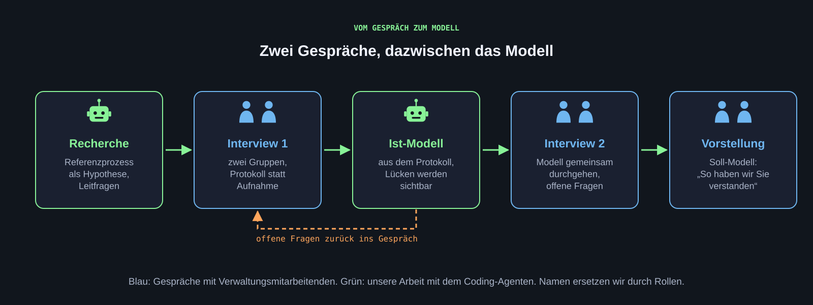

[Das Interview soll zeigen, wie eine Tätigkeit heute wirklich abläuft: welche Informationen hereinkommen, was damit geschieht, welche Entscheidung am Ende steht. Es fragt nicht nach Wunsch-Automatisierungen. Zwei Gruppen führen ein Gespräch gemeinsam, eine Person protokolliert. Eine Tonaufnahme ist mit Zustimmung möglich und wird nur lokal transkribiert.]{.lead}

## Worauf das Interview zielt {#fokus}

Wir suchen Tätigkeiten, bei denen Mitarbeitende unstrukturierte Informationen in strukturierte überführen und Entscheidungen vorbereiten: Übersichten erstellen, Unterlagen zusammenfassen, Angaben gegen Voraussetzungen prüfen, Rückfragen formulieren. Das sind die Stellen, an denen ein Agent eine Vorlage liefern kann, ohne in Systeme schreiben zu müssen.

Die Frage „Welchen Workflow würden Sie gern automatisieren?“ führt selten weiter. Besser fragen wir nach konkreten Vorgängen der letzten Wochen.

{.abbildung fig-alt="Kette aus Recherche, Interview 1, Ist-Modell, Interview 2 und Vorstellung; offene Fragen laufen vom Modell zurück ins Gespräch."}

::: {.abb-cap}
Zwei Gespräche, dazwischen das Modell. Was beim Modellieren unklar bleibt, wird im zweiten Gespräch geklärt.
:::

## Vorbereitung {#vorbereitung}

**Voraussetzungen:** Recherche abgeschlossen, Referenzprozess als Hypothese vorhanden, Leitfragen abgestimmt, Rollen im Gespräch verteilt.

1. Die beiden Gruppen legen ihre Leitfragen zusammen und einigen sich auf eine Reihenfolge: zuerst der Ablauf, dann die Informationen, dann die Entscheidungen, zuletzt die Schmerzpunkte.
2. Rollen verteilen: eine Person führt das Gespräch, eine protokolliert, eine achtet auf die Zeit und offene Punkte. Die zweite Gruppe ergänzt mit Nachfragen.
3. Den Referenzprozess als Bild mitnehmen, aber erst am Ende zeigen. Vorher soll die interviewte Person den eigenen Ablauf frei beschreiben.
4. Das Protokollraster vorbereiten (siehe unten).

**Prüfung:** Jede Leitfrage lässt sich mit einer Beschreibung beantworten, nicht mit ja oder nein.

## Leitfragen {#leitfragen}

Zum Ablauf:

- Beschreiben Sie bitte einen typischen Vorgang vom Eingang bis zum Abschluss. Was passiert zuerst, was danach?
- Wer ist beteiligt, und an welcher Stelle? Wer gibt etwas weiter, wer prüft, wer entscheidet, wer unterschreibt?
- Was passiert, wenn etwas fehlt oder nicht stimmt? An wen geht der Vorgang zurück?

Zu den Informationen:

- Welche Unterlagen und Angaben kommen herein, und in welcher Form (Formular, PDF, Mail, Systemauszug)?
- In welchen Systemen schauen Sie nach, und was suchen Sie dort?
- Wo dokumentieren Sie Ihre Prüfung und Ihre Entscheidung?

Zu Prüfung und Entscheidung:

- Welche Voraussetzungen prüfen Sie, und woher stammen die Regeln dafür (Ordnung, Richtlinie, Erfahrung)?
- Welche Fälle sind eindeutig, welche brauchen Ermessen?
- Was müsste eine Übersicht enthalten, damit Sie schneller und sicherer entscheiden könnten?

Zum Aufwand:

- Wie oft kommt der Vorgang vor, und wie lange dauert ein Fall ungefähr?
- Welcher Teil kostet am meisten Zeit? Welcher Teil ist am fehleranfälligsten?
- Welche Informationen sind vertraulich, und wer darf sie sehen?

## Protokoll {#protokoll}

Eine Person schreibt mit, direkt in ein Raster, auch dann, wenn aufgenommen wird:

| Spalte | Inhalt |
|---|---|
| Schritt | Was passiert, in der Reihenfolge des Gesprächs |
| Rolle | Wer den Schritt ausführt, als Rolle, nicht als Name |
| Eingang | Welche Information oder Unterlage hereinkommt, in welcher Form |
| System | Welches System dabei genutzt wird, lesend oder schreibend |
| Regel oder Ermessen | Feste Regel mit Quelle, oder Ermessensentscheidung |
| Rückschleife | Was bei Fehlern oder fehlenden Angaben passiert |
| Offene Frage | Was unklar geblieben ist |

Direkt nach dem Gespräch, am besten noch am selben Tag:

1. Das Protokoll gemeinsam ergänzen, solange die Erinnerung frisch ist.
2. Zitate nur sinngemäß festhalten, keine Namen von Personen, keine Namen von Studierenden oder Bewerbenden aus Beispielen.
3. Offene Fragen in eine eigene Liste für das zweite Gespräch übertragen.
4. Protokoll unter `02_Interviews` ablegen.

**Prüfung:** Aus dem Protokoll lässt sich der Ablauf als Prozessmodell zeichnen, ohne nachzufragen. Wo das nicht geht, steht eine offene Frage.

::: {.callout-warning title="Achtung"}
Wenn im Gespräch Beispielfälle mit echten Personen genannt werden, bleiben diese Angaben im Raum. Ins Protokoll kommt der Fall ohne Namen und ohne Merkmale, die eine Person erkennbar machen.
:::

## Tonaufnahme mit Zustimmung {#aufnahme}

Eine Aufnahme macht das Protokoll vollständiger und das Prozessmodell genauer, weil nichts verloren geht, was im Gespräch nur nebenbei gesagt wurde. Sie ist erlaubt, wenn die Gesprächspartnerin oder der Gesprächspartner vorher ausdrücklich zustimmt. Ohne Zustimmung bleibt es beim Protokoll.

**Voraussetzungen:** Zustimmung eingeholt und im Protokoll vermerkt (Datum, wer zugestimmt hat). Ein Rechner der Gruppe mit lokaler Transkription, zum Beispiel [Whisper](https://github.com/openai/whisper) oder eine darauf aufbauende App; auf dem Mac etwa [MacWhisper](https://goodsnooze.gumroad.com/l/macwhisper), unter Windows oder Linux etwa [Buzz](https://github.com/chidiwilliams/buzz). Alle Varianten laufen ohne Internetverbindung.

1. Zu Beginn des Gesprächs fragen: „Dürfen wir das Gespräch aufnehmen? Wir schreiben es nur auf unserem eigenen Rechner ab, nichts davon geht in eine Cloud, und wir löschen die Aufnahme danach.“ Die Antwort abwarten.
2. Bei Zustimmung mit dem Telefon oder Notebook aufnehmen. Trotzdem protokollieren; die Aufnahme ersetzt das Raster nicht.
3. Nach dem Gespräch die Aufnahme lokal transkribieren. Keine Cloud-Transkription, auch nicht über Gemini, ChatGPT oder einen Online-Dienst.
4. Im Transkript Namen von Personen durch Rollen ersetzen. Erst danach darf der Coding-Agent damit arbeiten, zum Beispiel für den Entwurf des Ist-Modells.
5. Aufnahme und Roh-Transkript löschen, sobald das bereinigte Transkript und das Protokoll stehen.

**Prüfung:** Im Protokoll steht die Zustimmung. Das bereinigte Transkript enthält keine Namen. Die Aufnahme ist gelöscht.

::: {.callout-warning title="Achtung"}
Eine Aufnahme ohne Zustimmung ist nicht erlaubt. Aufnahmen und Transkripte gehören nicht in die Teamablage, wenn diese in einem Cloud-Dienst liegt; dort liegt nur das bereinigte Transkript ohne Namen.
:::

## Das zweite Gespräch {#zweites}

Nach der Modellierung bleiben Lücken: Rollen, Ausnahmen, Rückschleifen. Das zweite Gespräch ist kürzer und arbeitet am Modell.

1. Das Ist-Modell ausdrucken oder auf dem Bildschirm zeigen.
2. Schritt für Schritt durchgehen: „Haben wir das richtig verstanden?“
3. Die offenen Fragen aus der Liste stellen.
4. Am Ende das Soll-Modell als Idee vorstellen und fragen, welche Schritte die Person einem Agenten überlassen würde und welche nicht.

**Ergebnis:** Ein bestätigtes Ist-Modell und eine erste Rückmeldung zum Soll-Modell.

## Umgang mit den Gesprächspartnerinnen und Gesprächspartnern {#haltung}

Die Verwaltungsmitarbeitenden nehmen sich Zeit für das Projekt. Dafür gilt: pünktlich sein, vorbereitet kommen, zuhören, nichts versprechen. Wir liefern Vorschläge und Prototypen mit erfundenen Daten. Ob etwas eingeführt wird, entscheidet die Hochschule. Diese Grenze benennen wir im Gespräch.

[**Weiter: n8n auf dem HdM-Server**](n8n.qmd)
