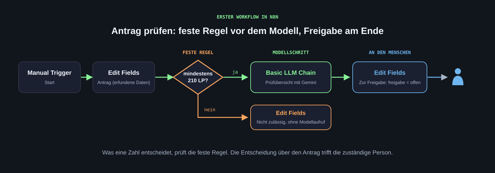

[Jede Gruppe hat eine eigene n8n-Instanz mit eigener Datenbank auf einem Server der HdM. Diese Seite beschreibt Login, den ersten Workflow, die vorbereiteten Verbindungen zu Modell und Datenbank, Webhooks und die häufigsten Fehler.]{.lead}

## Was n8n im Projekt leistet {#rolle}

[n8n](https://n8n.io/) ist ein Workflow-System: Ein **Trigger** startet den Ablauf, **Knoten** verarbeiten Daten Schritt für Schritt, Verzweigungen bilden Entscheidungen ab. Im Projekt übernimmt n8n das Gerüst des Soll-Prozesses: feste Regeln als If-Knoten, Modellschritte als Aufruf des Sprachmodells, Mock-Schnittstellen als Webhook oder Datenbankabfrage, und die Freigabe durch einen Menschen als eigener Schritt. Programmieren müssen wir dabei nicht; die Knoten werden in der Oberfläche verbunden, oder der Coding-Agent schreibt den Export als Datei.

| Begriff | Bedeutung |
|---|---|
| Workflow | Der Ablauf ist vorgegeben; ein Modell kann einzelne Schritte übernehmen |
| Agent | Das Modell wählt innerhalb gesetzter Grenzen Werkzeuge oder nächste Schritte |

Eine Basic LLM Chain mit festem Prompt ist noch kein Agent. Für die meisten Verwaltungsprozesse reicht ein Workflow. Ein Agent ist nur dann die bessere Wahl, wenn er gegenüber dem Workflow einen belegbaren Vorteil bringt. [Architekturgrundlage](https://www.anthropic.com/engineering/building-effective-agents).

## Login {#login}

**Voraussetzungen:** HdM-Netz oder [VPN](../start.qmd#vpn), Zugangsdaten der Gruppe.

1. Die Adresse der Gruppe öffnen: `https://141.62.116.2/n8n-<n>/`, mit der Gruppennummer statt `<n>`. Alle Adressen stehen in der [Vorbereitung](../start.qmd#n8n).
2. Die [Zertifikatswarnung](../start.qmd#zertifikat) einmal bestätigen.
3. Mit dem Gruppenkonto anmelden (`verwaltung-g<n>@hdm-stuttgart.de` und das Passwort der Gruppe).
4. Prüfen: Die Workflow-Übersicht erscheint. Unter „Credentials“ stehen „Postgres g<n>“ und „Gemini g<n>“.

Das Konto wird von der Gruppe gemeinsam genutzt. Die Adresse ist nur der Login-Name, es werden keine Mails dorthin verschickt.

## Der erste Workflow {#erster-workflow}

Ein Workflow, der einen erfundenen Antrag entgegennimmt und eine Prüfübersicht erstellt. Vier Knoten.

{.abbildung fig-alt="Workflow aus Manual Trigger, Edit Fields Antrag, If-Knoten mindestens 210 Leistungspunkte, Basic LLM Chain und Edit Fields zur Freigabe; der Nein-Zweig endet ohne Modellaufruf."}

::: {.abb-cap}
Der erste Workflow: Die feste Regel liegt vor dem Modellschritt, das Ergebnis geht zur Freigabe an eine Person.
:::

### 1. Start und Antrag

Einen neuen Workflow anlegen und „Antrag pruefen“ nennen. Einen **Manual Trigger** einfügen. Dahinter einen **Edit Fields (Set)**-Knoten, „Antrag“ nennen, Modus Manual Mapping, diese Felder als String:

| Feld | Beispiel |
|---|---|
| `antrag_id` | A-001 |
| `art` | Anmeldung Abschlussarbeit |
| `leistungspunkte` | 195 |
| `praxissemester` | abgeschlossen |
| `nachweise` | Praktikumszeugnis liegt vor; Anmeldeformular unterschrieben; Zweitgutachter fehlt |

Alle Werte sind erfunden. Beide Knoten verbinden, ausführen, Ausgabe prüfen: Alle fünf Felder kommen an.

### 2. Feste Regel

Einen **If**-Knoten einfügen, „Mindestens 210 LP?“ nennen. Bedingung: `{{ $json.leistungspunkte }}` als Zahl größer oder gleich 210. Der Zweig `true` führt weiter zum Modell, der Zweig `false` zu einem Edit-Fields-Knoten „Nicht zulaessig“ mit `ergebnis = Voraussetzung Leistungspunkte nicht erfüllt`. Die feste Regel liegt vor dem Modell: Was eine Zahl entscheidet, soll kein Modell raten.

### 3. Modellschritt {#gemini}

Im Zweig `true` eine **Basic LLM Chain** einfügen, „Pruefuebersicht“ nennen. Prompt selbst definieren (Define below), Expression-Modus. Der Auftrag folgt dem [Prompt-Standard](einrichtung.qmd#prompt):

```default
Kontext: Antrag {{ $json.antrag_id }}, Art: {{ $json.art }}.
Leistungspunkte: {{ $json.leistungspunkte }}. Praxissemester: {{ $json.praxissemester }}.
Nachweise laut Akte: {{ $json.nachweise }}.
Voraussetzungen laut Ordnung: mindestens 210 Leistungspunkte, Praxissemester
abgeschlossen, Anmeldeformular unterschrieben, Erst- und Zweitgutachter benannt.
Alle Angaben sind erfundene Testdaten.

Aufgabe: Erstelle eine Prüfübersicht für die zuständige Person.

Format: Tabelle mit den Spalten Voraussetzung, Status (erfüllt, nicht erfüllt,
unklar), Grundlage. Danach ein Satz mit der Empfehlung. Deutsch, Sie-Form.

Prüfung: Nenne am Ende, welche Angaben fehlen oder unklar sind, statt sie zu
ergänzen. Triff keine Entscheidung; die Entscheidung trifft die zuständige Person.
```

Unter Chat Model den Knoten **Google Gemini Chat Model** verbinden und die Verbindung **Gemini g<n>** der Gruppe auswählen. Als Modell ein Flash-Modell einstellen; welches, wird in der Vorlesung genannt. Das eigene Google-Konto wird hier nicht eingetragen: Die Gemini-App und die Gemini-API sind getrennte Zugänge, die vorbereitete Verbindung läuft über ein Kontingent des Projekts.

Ausführen und die Ausgabe lesen. Die Platzhalter `{{ $json.feld }}` sind Feldzuordnungen aus dem vorherigen Knoten, keine Programmierung. In der Vorschau müssen die tatsächlichen Werte erscheinen.

### 4. Ergebnis zur Freigabe

Einen **Edit Fields**-Knoten anhängen, „Zur Freigabe“ nennen, mit den Feldern `antrag_id` (Ausdruck `{{ $('Antrag').item.json.antrag_id }}`), `uebersicht` (Ausdruck `{{ $json.text }}`) und `freigabe` (fester Text `offen`). Der Status `offen` stammt aus fester Logik, nicht aus dem Modell. Die Entscheidung trifft später eine Person.

Workflow speichern. Export: Workflow-Menü, „Download“. Die JSON-Datei in die Teamablage unter `04_Prototyp`. Der Export enthält keine Zugangsdaten, nur den Namen der Verbindung.

**Prüfung:** Ein Antrag mit 195 Leistungspunkten endet im Zweig „Nicht zulaessig“, ohne Modellaufruf. Ein Antrag mit 215 Leistungspunkten erzeugt eine Übersicht, die den fehlenden Zweitgutachter als „unklar“ oder „nicht erfüllt“ führt und keine Entscheidung trifft.

## Freigabe durch einen Menschen {#freigabe}

Im Prototyp muss die Freigabe als eigener Schritt sichtbar sein. Drei Wege, von einfach zu aufwendig:

1. **Ausführungsprotokoll:** Die Übersicht bleibt in n8n stehen, eine Person liest sie dort und dokumentiert die Entscheidung in der Teamablage. Für die ersten Tests ausreichend.
2. **Formular-Trigger in n8n:** Der Knoten **n8n Form** erzeugt eine kleine Web-Seite im HdM-Netz. Die Übersicht wird angezeigt, die Person wählt „freigeben“ oder „zurückgeben“, der Workflow läuft mit der Antwort weiter. Der Knoten **Wait** kann einen Workflow anhalten, bis diese Antwort eintrifft.
3. **Eigene Web-Oberfläche:** Der Coding-Agent baut eine einfache Seite, die den Webhook des Workflows aufruft. Nur sinnvoll, wenn das Formular nicht reicht.

Kein Weg schreibt in ein Verwaltungssystem. Was nach der Freigabe passieren würde (Eintrag im System, Mail an Antragstellende), wird im Prototyp nur als Ausgabe dargestellt und in der Dokumentation beschrieben.

## Mock-Schnittstellen mit Webhooks {#webhook}

Ein **Webhook**-Knoten macht einen Workflow über eine Adresse aufrufbar. So lässt sich ein echtes System nachbauen: Ein kleiner Workflow „Mock Campus-System“ nimmt eine Antrags-ID entgegen und antwortet mit erfundenen Daten, so wie das echte System antworten würde. Der Prototyp ruft diesen Mock auf, statt auf ein echtes System zuzugreifen.

Die Adresse lautet `https://141.62.116.2/n8n-<n>/webhook/<pfad>`. Der Pfad wird im Webhook-Knoten festgelegt. Damit sich die Gruppen nicht in die Quere kommen, beginnt jeder Pfad mit der Gruppennummer, zum Beispiel `g3-campus-mock`. Webhooks sind wie alles andere nur aus dem HdM-Netz und über VPN erreichbar; externe Dienste erreichen sie nicht.

Zum Testen in n8n „Listen for test event“ wählen und die Adresse im Browser aufrufen. Für den Dauerbetrieb den Workflow aktivieren; dann gilt die Produktionsadresse ohne `-test`.

## Datenbank und Vektorsuche {#postgres}

Jede Gruppe hat eine eigene Postgres-Datenbank mit der Erweiterung pgvector. Die Verbindung **Postgres g<n>** ist im Konto hinterlegt. Zwei Einsatzzwecke:

- **Mock-Daten:** Eine Tabelle mit erfundenen Anträgen oder Studierenden, die der Prototyp mit dem **Postgres**-Knoten liest. Der Coding-Agent erzeugt die SQL-Anweisungen zum Anlegen und Befüllen; ausgeführt werden sie in einem Postgres-Knoten.
- **Wissenssuche über Dokumente:** Ordnungen, Merkblätter und Formulare (öffentliche oder erfundene) werden mit dem Knoten **PGVector Vector Store** abgelegt und per Ähnlichkeitssuche gefunden, damit das Modell mit der passenden Textstelle antwortet. Der Knoten legt die Tabelle `n8n_vectors` selbst an. Für Einbettungen den Knoten **Embeddings Google Gemini** mit der Gemini-Verbindung der Gruppe verwenden.

Die Datenbank der Gruppe ist nur für die Gruppe sichtbar. Auch hier gilt: keine Realdaten.

## Wenn ein Lauf nicht funktioniert {#fehler}

| Beobachtung | Nächster Prüfschritt |
|---|---|
| Seite lädt nicht, Zeitüberschreitung | VPN verbunden? Adresse mit `/n8n-<n>/` am Ende? |
| Zertifikatswarnung erneut | Anderer Browser oder Ausnahme gelöscht; einmal neu bestätigen |
| Verbindung im Modellknoten fehlt | „Gemini g<n>“ aus der Liste wählen; keinen eigenen Schlüssel eintragen |
| Modell antwortet mit Fehler oder Kontingent | Fehlermeldung ohne Zugangsdaten notieren und im Wochentermin melden |
| Leeres Feld im Prompt | Schreibweise des Feldes und Zuordnung im Antrag-Knoten prüfen |
| Webhook antwortet nicht | Pfad mit Gruppenpräfix prüfen; Test-Adresse nur, solange „Listen for test event“ aktiv ist |
| Postgres-Fehler „permission denied“ | Die Gruppe sieht nur die eigene Datenbank; Tabellenname und Schema prüfen |
| Formal korrekt, fachlich falsch | Regel, Prompt und Testfall vergleichen; der Fehler liegt meist im Kontext |

## Vom Soll-Modell zum Workflow {#vom-modell}

Wenn das Soll-Modell steht, kann der Coding-Agent einen ersten Workflow-Export daraus erzeugen. Zuordnung: Startereignis zu Trigger, feste Regel zu If-Knoten, Modellschritt zu Basic LLM Chain, Systemabfrage zu Webhook- oder Postgres-Knoten gegen einen Mock, menschliche Schritte bleiben außerhalb des Workflows und werden als Freigabe-Schritt sichtbar. Den Export in n8n importieren („Import from File“), Verbindungen auswählen, mit zwei Testfällen ausführen und gegen das Modell prüfen: Liegt jeder Knoten an der Stelle, die das Modell vorsieht? Fehlt ein Schritt? Hat der Agent etwas ergänzt, das nicht im Modell steht?

## Technische Quellen

[n8n-Dokumentation](https://docs.n8n.io/) · [KI in n8n](https://docs.n8n.io/build/integrate-ai) · [Basic LLM Chain](https://docs.n8n.io/integrations/builtin/cluster-nodes/root-nodes/n8n-nodes-langchain.chainllm/) · [Google Gemini Chat Model](https://docs.n8n.io/integrations/builtin/cluster-nodes/sub-nodes/n8n-nodes-langchain.lmchatgooglegemini/) · [Vektoren und RAG in n8n](https://docs.n8n.io/build/integrate-ai/understand-ai-components/store-and-search-data-with-vectors) · [Webhook](https://docs.n8n.io/integrations/builtin/core-nodes/n8n-nodes-base.webhook/) · [n8n Form Trigger](https://docs.n8n.io/integrations/builtin/core-nodes/n8n-nodes-base.formtrigger/)
