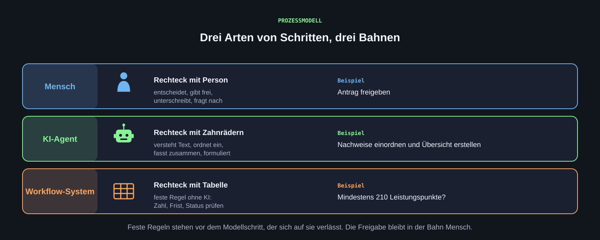
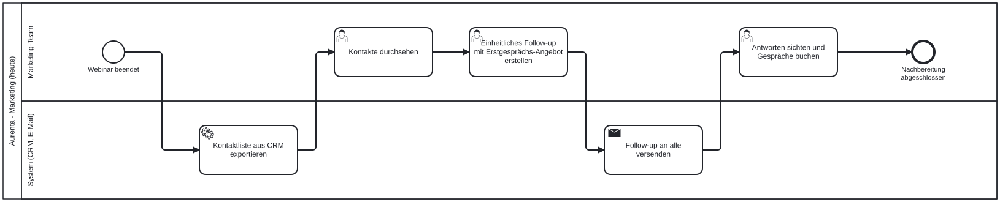
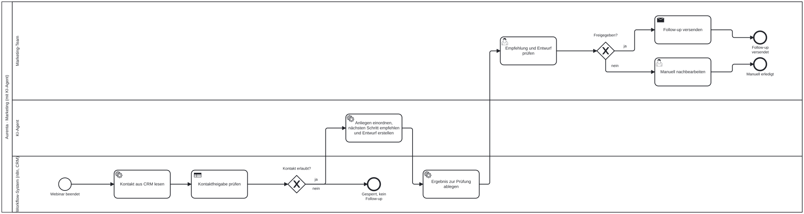

[Ein Prozessmodell zeigt, wer welchen Schritt ausführt, wo entschieden wird und wo ein Agent sinnvoll ist. Es ist die Grundlage für das Interview, für das zweite Gespräch und für den Prototyp in n8n.]{.lead}

## Warum zuerst modellieren

Ein Agent unterstützt einen Ablauf. Wer den Ablauf nicht kennt, baut am Problem vorbei. Das Modell macht drei Dinge sichtbar: welche Schritte **feste Regeln** sind und ohne Modell funktionieren (ist die Zahl der Leistungspunkte erreicht?), wo **Sprachverständnis** nötig ist (was steht in diesem Nachweis, und passt er zur Anforderung?) und wo ein **Mensch prüfen und freigeben** muss. Außerdem wird aus dem Soll-Modell die Vorlage für den Prototyp: Der Coding-Agent kann aus einem klaren Modell einen ersten n8n-Workflow erzeugen, wir prüfen ihn gegen das Modell.

## Swimlane-Diagramm in BPMN 2.0

Die Notation ist BPMN 2.0 (Business Process Model and Notation), dieselbe, die Prozessmanagement-Werkzeuge in Unternehmen und Verwaltungen verwenden. Für das Projekt reichen Bahnen und sechs Symbole.

| Element | Bedeutung |
|---|---|
| Waagerechte Bahn (Lane) | Wer den Schritt ausführt, etwa Antragstellende, Sachbearbeitung, Ausschuss, KI-Agent, Workflow-System |
| Rechteck mit Person | Ein Mensch entscheidet oder arbeitet |
| Rechteck mit Tabelle | Feste Regel ohne KI, etwa „mindestens 210 Leistungspunkte“ |
| Rechteck mit Zahnrädern | Modellschritt oder Systemaufruf, etwa eine Zusammenfassung durch den Agenten oder eine Abfrage im Campus-System |
| Raute mit X | Entscheidung; die Pfeile tragen die Antworten (ja, nein) |
| Dünner Kreis, dicker Kreis | Start und Ende |

**Lesen:** von links nach rechts entlang der Pfeile. Jeder Schritt liegt in genau einer Bahn. Ein Modellschritt liegt in der Bahn „KI-Agent“, eine feste Regel im „Workflow-System“, die Freigabe bleibt beim Menschen.

{.abbildung fig-alt="Drei Bahnen Mensch, KI-Agent und Workflow-System mit je einem Symbol, einer Beschreibung und einem Beispiel aus der Anmeldung einer Abschlussarbeit."}

::: {.abb-cap}
Drei Arten von Schritten, drei Bahnen. Feste Regeln stehen vor dem Modellschritt, die Freigabe bleibt beim Menschen.
:::

Wer ereignisgesteuerte Prozessketten (EPK) kennt: Funktionen entsprechen den Rechtecken, Konnektoren den Rauten, Organisationseinheiten den Bahnen.

## Beispiel: Ablauf heute und mit Agent

Das Beispiel stammt aus einem anderen Projekt und ist vollständig erfunden: Eine fiktive Beratung fasst nach einem Webinar bei ihren Kontakten nach. Es zeigt die Form, nicht den Inhalt für die Verwaltung.

**Heute:** Das Team erledigt alle Schritte von Hand.

{fig-alt="Swimlane-Diagramm des heutigen Ablaufs: alle Schritte der Webinar-Nachbereitung liegen in der Bahn Marketing-Team."}

**Mit Agent:** Feste Regeln wie die Kontaktsperre prüft das Workflow-System vor dem Modellschritt, der KI-Agent erstellt einen Entwurf, Freigabe und Versand bleiben beim Team.

{fig-alt="Swimlane-Diagramm mit drei Bahnen Marketing-Team, KI-Agent und Workflow-System; die Kontaktsperre liegt vor dem KI-Schritt, Freigabe und Versand beim Team."}

BPMN-Dateien zum Öffnen und Verändern in [demo.bpmn.io](https://demo.bpmn.io/): [heute](../material/prozess/aurenta-webinar-ist.bpmn), [mit Agent](../material/prozess/aurenta-webinar-soll.bpmn).

## Übertragen auf einen Verwaltungsprozess

Beispiel Anmeldung einer Abschlussarbeit, nach der Beschreibung aus dem Projektvorfeld. Vier Fragen helfen beim Übertragen:

- **Feste Regel oder Modellschritt?** Leistungspunkte, abgeschlossenes Praxissemester, Fristen stehen in einer Ordnung. Sie lassen sich als Regel prüfen und sollten nicht vom Modell erraten werden.
- **Wo braucht es Sprachverständnis?** Ein Nachweis als PDF lesen und einordnen, eine Übersicht über mehrere Anträge erstellen, eine Rückfrage an die antragstellende Person formulieren.
- **Woher stammt jede Information?** Jede Angabe im Ergebnis nennt ihre Quelle: Formularfeld, Systemauszug, Nachweisdokument. Im Prototyp sind diese Quellen Mocks.
- **Wer prüft?** Der Agent erstellt die Prüfübersicht, die zuständige Person entscheidet und dokumentiert.

Rückschleifen gehören ins Modell: Was passiert bei einem fehlenden Nachweis? Wer informiert wen? Diese Stellen sind im ersten Interview meist unvollständig und werden im zweiten Gespräch geklärt.

## Vom Ist zum Soll

1. **Ist-Modell** aus dem Interviewprotokoll: eine Bahn je Rolle, jeder Satz des Protokolls höchstens ein Schritt, keine Schritte erfinden, Unklares als Frage in die Dokumentation des Schritts.
2. **Soll-Modell** mit KI-Agent: dieselben Ziele, zusätzlich die Bahnen „KI-Agent“ und „Workflow-System“. Feste Regeln stehen vor jedem Modellschritt. Freigabe und Entscheidungen mit Außenwirkung bleiben beim Menschen.
3. **Begründung** als Tabelle mit drei Spalten: „Entfällt“, „Bleibt beim Menschen“, „Neu“. Dazu drei Sätze: Was ändert sich an der Durchlaufzeit, welche Übergaben fallen weg, was müsste ein Pilot messen?

Die Aufträge für den Coding-Agenten stehen fertig in den Materialien: [Ist-Prozess aus einer Beschreibung](../material/prompts/ist-aus-prosa.md) und [Prozess mit KI neu denken](../material/prompts/redesign-mit-ki.md). Ein Soll-Modell ist eine Gestaltungshypothese, kein Beweis.

## Werkzeuge

- [demo.bpmn.io](https://demo.bpmn.io/): öffnet, zeigt und bearbeitet `.bpmn`-Dateien direkt im Browser, exportiert als SVG
- [draw.io](https://app.diagrams.net/): kostenlos im Browser, Formenbibliothek „BPMN 2.0“ über „Weitere Formen“ aktivieren; für Skizzen von Hand
- Der Coding-Agent schreibt die `.bpmn`-Datei; wir sehen sie in demo.bpmn.io an und formulieren Korrekturen als neuen Auftrag

Für die Teamablage die bearbeitbare Datei und einen Export als SVG oder PNG speichern, im Ordner `03_Prozessmodelle`.

[**Weiter: Interviews führen**](interviews.qmd)
